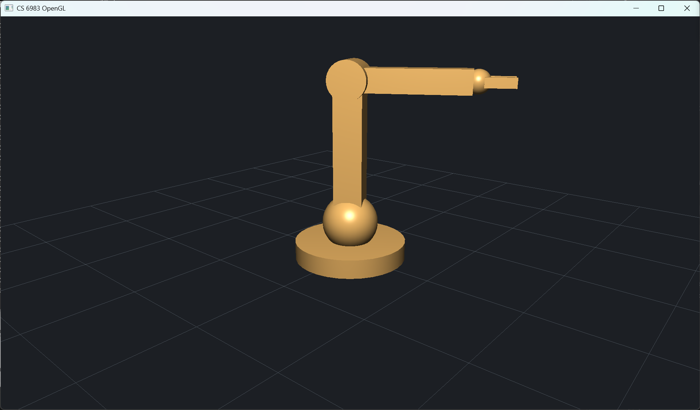

# CS 6983 Coding Assignment 2 — Robot Arm in OpenGL

A robot arm modeled in Blender and rendered in OpenGL with a Blinn-Phong shader.

## Build & Run (Windows)

Requires CMake 3.24+, Git, and Visual Studio 2022 (C++ workload).

    cmake -S . -B build
    cmake --build build --config Debug
    .\build\Debug\cs6983_opengl_intro.exe

Controls: drag or arrow keys to orbit, wheel or -/= to zoom, Esc to quit.

## Files

| Path | Description |
|---|---|
| `assets/robot_arm.blend` | Blender source model |
| `assets/robot_arm.obj` | Exported mesh (triangulated, with normals) |
| `src/obj_loader.hpp` | OBJ parser: positions + normals → interleaved vertex array |
| `src/main.cpp` | Uploads the mesh, sets lighting uniforms, draws the scene |
| `shaders/blinn_phong_vert.glsl` | Transforms positions and normals to world space |
| `shaders/blinn_phong_frag.glsl` | Blinn-Phong: C = (ka·Ia + kd·max(N·L,0))·Il + ks·Il·max(N·H,0)^α |

## Lighting parameters

| Symbol | Value |
|---|---|
| Light position | (3, 5, 4) |
| Il | (1, 1, 1) |
| Ia | (0.2, 0.2, 0.2) |
| ka, kd | (0.83, 0.64, 0.36) |
| ks | (0.5, 0.5, 0.5) |
| α | 64 |